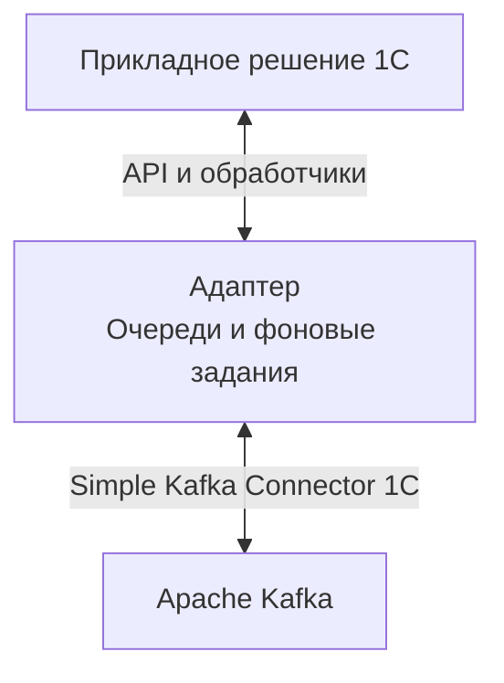

# Архитектура

Прикладное решение работает с адаптером через публичный API и обработчики. Адаптер хранит состояние обмена в регистрах 1С, управляет фоновыми заданиями и обращается к Kafka через внешнюю компоненту.

## Состав подсистемы { #components }

| Компонент | Ответственность |
|---|---|
| Общие модули `кфкИнтеграция` и `кфкИнтеграцияКлиент` | [Публичный API](../user/development/api.md). Регистрация, управление обменом и методы прямой работы с Kafka. |
| Подписки на события | Выбирают изменения по настройкам продюсеров и регистрируют их в исходящей очереди. |
| Регистры «Исходящие сообщения» и «Входящие сообщения» | Хранят данные, статусы и журнал сообщений. Служебные регистры хранят назначения потоков, позиции операций и хэши. |
| Диспетчеры и фоновые задания | Выполняют сериализацию, выгрузку, загрузку и десериализацию. Отдельные операции обслуживают очереди и проверяют ошибки. |
| Обработчики прикладного решения | Формируют тело исходящего сообщения или обрабатывают тело входящего. Можно задать экспортный метод либо правила [КД 3.1](../user/development/conversion-data.md). |
| [Simple Kafka Connector 1C](https://github.com/NuclearAPK/Simple-Kafka_Adapter) | Выполняет обращения к Kafka. Компонента на базе librdkafka входит в поставку адаптера. |
| Панель администрирования | Включает обмен, настраивает задания, позволяет наблюдать за состоянием подсистемы. |

## Границы ответственности { #responsibilities }

Прикладное решение отвечает за схему сообщения, бизнес-ключи и результат обработки в 1С. Адаптер отвечает за регистрацию, очереди, транспорт и техническую диагностику. Доступность Kafka, параметры топиков и права в кластере обеспечивает владелец Kafka.

У прямого API собственный цикл работы с транспортной сессией. Постановку сообщений в очередь и фоновую обработку использует [обмен через очереди](data-flow.md). Правила работы с сессией описаны в [справочнике прямого API](../user/development/direct-api.md).

Подробности открывайте на страницах [Модули](../project/modules.md), [Метаданные](../project/metadata.md) и [Принципы и ограничения](principles.md).
