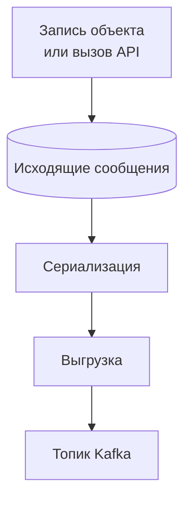
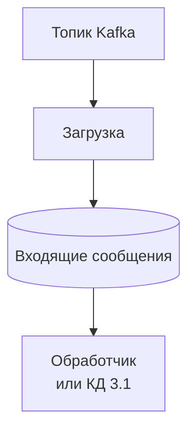

# Потоки данных

При обмене через очереди адаптер выполняет отправку в Kafka и прикладную обработку в фоновых заданиях. По статусу записи видно, на каком этапе остановилось сообщение.

## Из 1С в Kafka { #outgoing }

1. **Регистрация.** Подписка на запись объекта или вызов `кфкИнтеграция.ПоместитьВОчередьИсходящих` подбирает продюсеров по полю **Тип объект**. Для регистра, подчинённого регистратору, в очереди хранится ссылка на регистратор. [Настройка продюсера](../user/configuration/producers.md#registration-type)
2. **Сериализация.** Фоновый поток формирует тело произвольным обработчиком или правилами КД 3.1. Готовое тело можно зарегистрировать сразу для отправки. [Пример готового сообщения](../user/examples/custom-events.md)
3. **Выгрузка.** Поток отправляет сообщение через Simple Kafka Connector 1C и записывает результат в очередь. [Статусы и повторы](../user/operations/statuses.md#outgoing)

По умолчанию адаптер отбирает последнюю регистрацию по ключу записи. Если включена идемпотентная отправка, перед публикацией он сравнивает хэш тела с последней успешной выгрузкой по тому же ключу. [Дедупликация регистраций](../user/configuration/producers.md#registration-deduplication) · [Идемпотентная отправка](../user/configuration/producers.md#idempotent-send)

## Из Kafka в 1С { #incoming }

1. **Загрузка.** Поток читает настроенные топики и сохраняет сообщения со статусом **Новое**. В записи доступны тело, ключ, топик, раздел и смещение. [Настройка консьюмера](../user/configuration/consumers.md)
2. **Обработка.** Диспетчер отбирает новые записи по метке изменения. Поток передаёт тело в обработчик и сохраняет статус и журнал. При включённой проверке хэша адаптер может пропустить уже обработанное тело по тому же ключу записи. [Идемпотентная обработка](../user/configuration/consumers.md#idempotent-processing)

Обработчик может отложить новую попытку. Запись остаётся в статусе **Новое**, а фоновый поток допускает её к обработке после задержки. [Отложенный повтор](../user/development/consumer-handler.md#deferred-retry)

## Где смотреть результат { #where-to-check }

| Что проверяете | Где смотреть |
|---|---|
| Регистрация и отправка | **Kafka → Исходящие сообщения**, журнал записи и история выгрузки объекта. Ошибки автоматической регистрации также попадают в журнал регистрации 1С. |
| Чтение и обработка | **Kafka → Входящие сообщения**, журнал записи и результат в данных 1С. |
| Работа диспетчеров | **Kafka → Администрирование → Фоновые задания**. |

Параметры запуска и параллельности описаны в разделе [Фоновые и регламентные задания](../user/configuration/jobs.md). Если очередь остановилась, начните со страницы [Типовые проблемы](../user/operations/troubleshooting.md).
