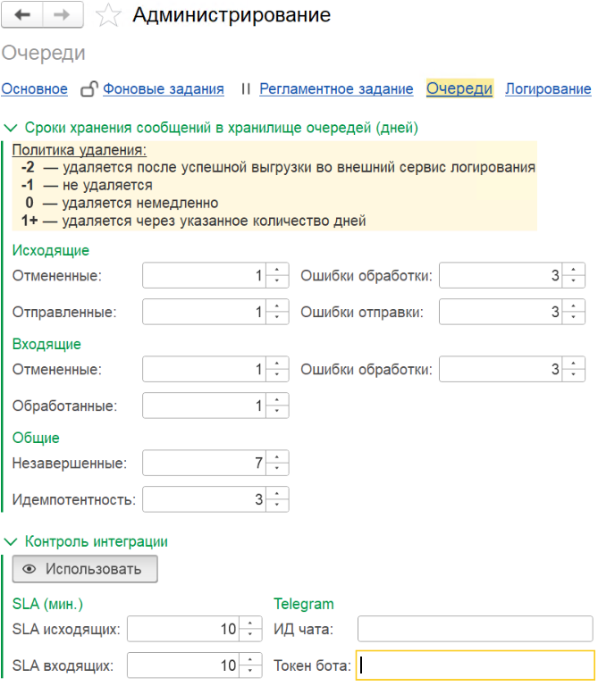

# Очереди и уведомления

Откройте **Kafka / Администрирование / Очереди**.

{ loading=lazy }

## Сроки хранения сообщений

Задаются **раздельно** для каждого статуса исходящих и входящих сообщений:

| Значение | Поведение |
|----------|-----------|
| `-2` | Удалять **после выгрузки** в сервис [внешнего логирования](logging.md) |
| `-1` | **Не удалять** |
| `0` | Удалять **немедленно**. Если включено [внешнее логирование](logging.md) — ведёт себя как `-2`: удаление происходит только **после выгрузки** записи |
| `N` | Удалять через `N` дней |

Отдельное поле **Идемпотентность** задаёт срок хранения (в днях, по умолчанию **3**) записей регистра «Хэш-суммы сообщений» — истории хэшей для [идемпотентной отправки и обработки](producers.md#idempotent-send). После удаления хэша совпадение с ним больше не влияет на отправку или обработку.

Удаление по срокам хранения выполняет регламентное задание. Ручная очистка очередей — [Обслуживание очередей](../operations/queue-maintenance.md).

## Контроль интеграции { #integration-alerts }

При сохранении настроек форма проверяет положительный срок хранения для обработанных, отправленных и трёх групп ошибок: входящей обработки, исходящей обработки и отправки.

При каждом запуске контроль ошибок и SLA входящих сообщений проверяет записи от первой метки после сохранённой позиции до максимальной метки на момент выборки включительно. Уведомления зависят от времени запуска проверки. У внешних логов отдельный цикл выгрузки. [Как работает выгрузка](logging.md#export-process)

| Поле / кнопка | Описание |
|---------------|----------|
| **Использовать** | Включает/выключает контроль интеграции |
| **SLA исходящих** | Допустимое время обработки исходящих сообщений (мин.) |
| **SLA входящих** | Допустимое время обработки входящих сообщений (мин.) |
| **Окно анализа** | Период, за который проверяются нарушения SLA (мин.) |
| **ИД чата** | Идентификатор чата Telegram для алертов |
| **Токен бота** | Токен Telegram-бота |

### Как настроить Telegram-бота

1. В Telegram найдите [@BotFather](https://t.me/BotFather) и создайте бота командой `/newbot`.
2. Получите **токен бота** — длинная строка вида `1234567890:AA...`.
3. Создайте **чат** или **канал** и добавьте туда бота с правом отправки сообщений.
4. Получите **идентификатор чата** через Telegram Bot API, например из поля `chat.id` в обновлении `getUpdates`.
5. Внесите оба значения в настройки контроля.
6. В тестовой среде проверьте, приходит ли уведомление после очередного запуска контроля.
