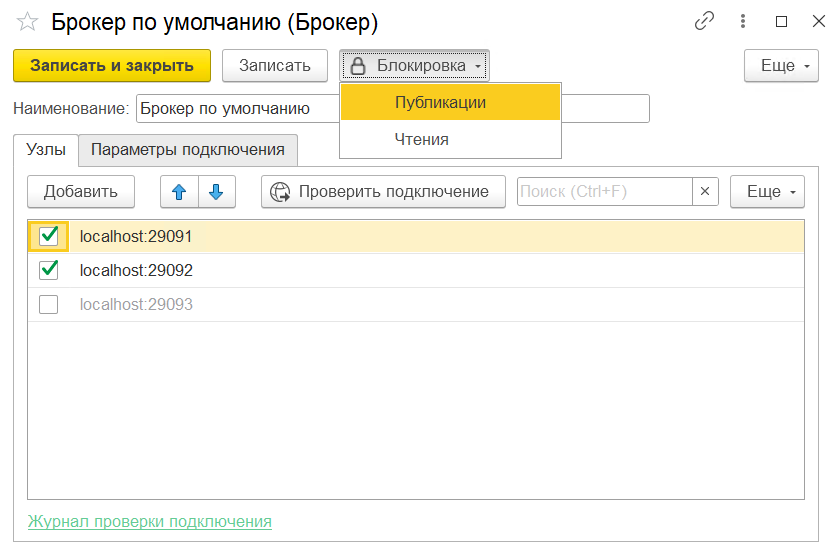

# Брокеры

Элемент справочника **Брокеры** хранит параметры подключения к кластеру Kafka. Создайте элемент в разделе **Kafka → Брокеры** и выберите его в настройках продюсера или консьюмера.

{ loading=lazy }

## Адреса узлов { #bootstrap-servers }

Укажите наименование подключения. В таблицу узлов добавьте адреса bootstrap-серверов в формате `host:port` и отметьте записи, которые нужно использовать. Несколько доступных адресов позволяют Kafka-клиенту получить метаданные кластера при недоступности одного узла.

## Параметры подключения { #connection-parameters }

В таблице дополнительных параметров `Ключ` — имя настройки librdkafka, `Значение` — её значение. Например, протокол подключения задаётся в `security.protocol`. Флаг **Режим пароля** маскирует значение в форме.

Действительные параметры подключения определяет конфигурация кластера. [Пример SASL и TLS](../examples/secure-connection.md) · [Справочник librdkafka](https://github.com/confluentinc/librdkafka/blob/master/CONFIGURATION.md)

## Управление обменом { #exchange-control }

Команды **Блокировка → Публикации** и **Блокировка → Чтения** управляют соответствующим направлением обмена для этого подключения.

Запись настроек брокера учитывается при автоматическом перезапуске потоков. При ручном запуске после сохранения перезапустите потоки в панели администрирования. [Когда применяются настройки](jobs.md#settings-restart)

Ошибки подключения и получения списка топиков разбираются на странице [Типовые проблемы](../operations/troubleshooting.md).
