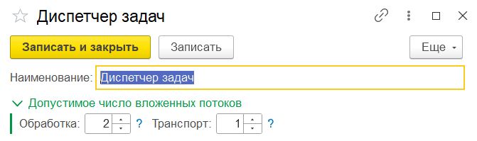
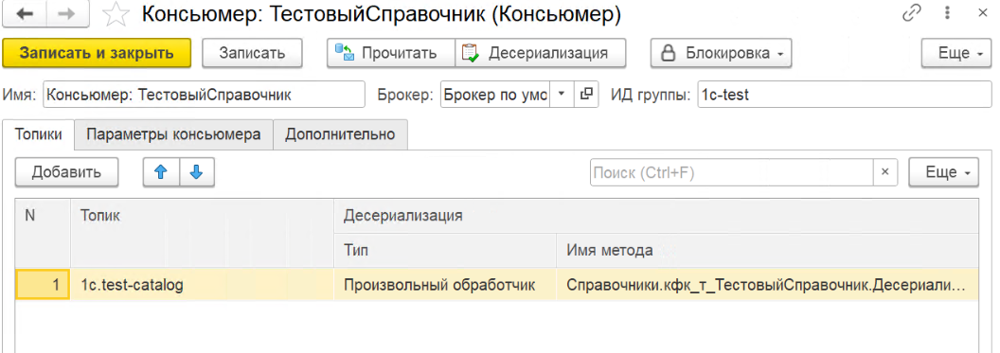
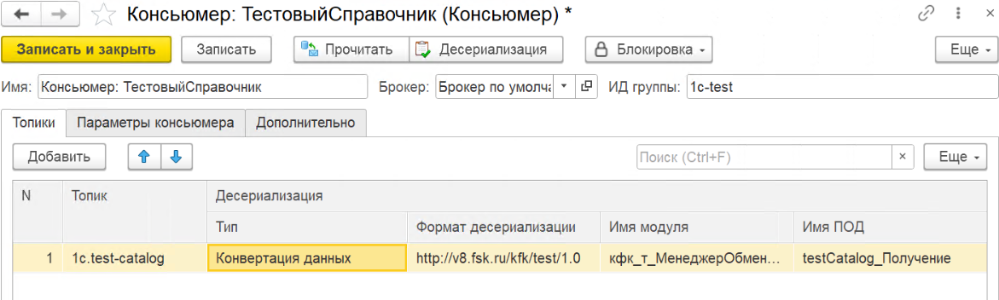
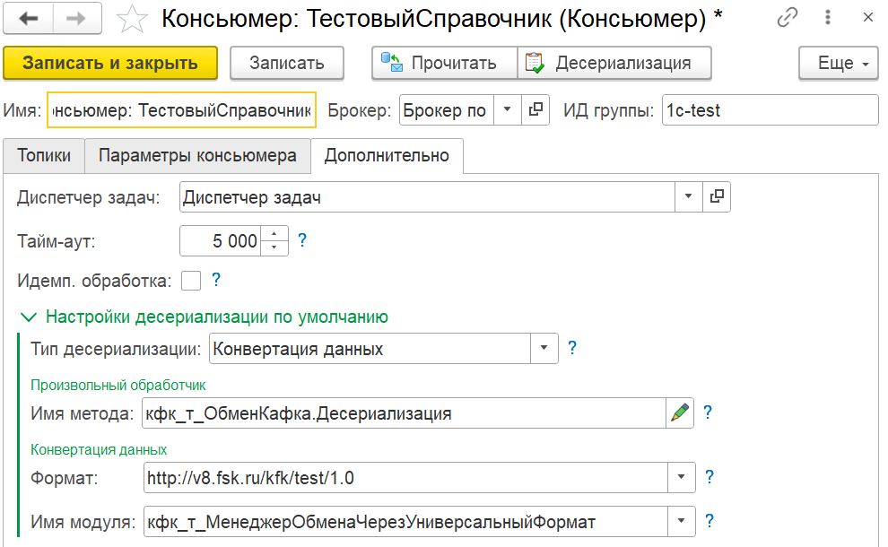

# Консьюмеры

**Консьюмер** (consumer) — получатель сообщений из Kafka.

Справочник **Консьюмеры** имеет **двухуровневую** структуру:

- **Диспетчер задач** — группа консьюмеров с общими параметрами параллелизма;
- **Консьюмер** — настройки чтения для конкретного топика.

---

## Диспетчер задач

Создаётся **отдельной кнопкой** в списке консьюмеров.

{ loading=lazy }

### Поля диспетчера

| Поле | Описание |
|------|----------|
| **Наименование** | Произвольное название диспетчера |
| **Подпотоки обработки** | Количество параллельных потоков **десериализации** |
| **Подпотоки транспорта** | Количество параллельных потоков **чтения** из Kafka |

---

## Консьюмер

=== "Произвольный обработчик"

    { loading=lazy }

=== "Конвертация данных"

    { loading=lazy }

=== "Дополнительно"

    { loading=lazy }

    В примере выбран тип **Конвертация данных**, а формат задан точным URI `http://v8.fsk.ru/kfk/test/1.0`. Подробнее — [Настройки десериализации по умолчанию](#настройки-десериализации-по-умолчанию).

### Команды формы

| Команда | Описание |
|---------|----------|
| **Блокировка / Чтения** | Останавливает получение новых сообщений из Kafka |
| **Блокировка / Десериализации** | Останавливает обработку полученных сообщений |

### Основные поля

| Поле | Описание |
|------|----------|
| **Наименование** | Произвольное название консьюмера |
| **Брокер** | Брокер Kafka, из которого читаются сообщения |
| **Идентификатор** | Идентификатор группы консьюмеров (`consumer group id`) — все консьюмеры с одним идентификатором получают **разные** сообщения из топика |
| **Тайм-аут ожидания** | Время ожидания сообщений от брокера в миллисекундах |
| **Двоичные данные** | Получать тело сообщения как двоичные данные (не преобразовывать в строку) |
| **Идемпотентная обработка** | Не обрабатывать повторно сообщения с одинаковым содержимым — см. [ниже](#идемпотентная-обработка) |

### Идемпотентная обработка { #идемпотентная-обработка }

При включённом флаге адаптер перед десериализацией сравнивает **SHA-256-хэш тела сообщения** с хэшем последней успешной обработки по тому же ключу записи очереди (регистр «Хэш-суммы сообщений»). Если содержимое не изменилось — обработчик **не вызывается**: запись получает статус **«Обработка отменена»** с текстом «Сообщение уже обработано». Если содержимое изменилось — сообщение обрабатывается, а сохранённый хэш обновляется.

- Настройка включается **независимо для каждого консьюмера**.
- Сравнение выполняется для сообщений с одинаковым **`КлючЗаписи`**, включая разные загрузки в локальную очередь. История хранит хэш последней успешной обработки по этому ключу.
- Срок хранения истории хэшей (по умолчанию **3 дня**) настраивается в поле **Идемпотентность** на вкладке **Kafka / Администрирование / Очереди**.

Подробнее о сценариях и способах форсировать повторную обработку — [Идемпотентность](../examples/idempotency.md).

!!! warning "Consumer group id"
    Если два консьюмера настроены с **одним** `consumer group id` и подписаны на один топик — Kafka будет **распределять** сообщения между ними (каждое сообщение уходит только одному). Для **параллельной** обработки одного потока сообщений несколькими консьюмерами используйте **разные** идентификаторы.

### Настройки десериализации по умолчанию { #настройки-десериализации-по-умолчанию }

На вкладке **Дополнительно** в группе **Настройки десериализации по умолчанию** можно задать общие параметры для строк табличной части **Топики** этого консьюмера:

| Поле | Когда используется |
|------|--------------------|
| **Тип десериализации** | **Конвертация данных** или **Произвольный обработчик** |
| **Имя метода** | Для произвольного обработчика — полное имя экспортной процедуры |
| **Имя модуля** | Для КД 3.1 — имя общего модуля менеджера обмена |
| **Формат** | Для КД 3.1 — URI пространства имён XDTO-пакета или [маска](../development/conversion-data.md#подбор-формата-xdto) |

Каждое поле наследуется независимо: заполненное значение строки имеет приоритет, а пустое берётся из настроек по умолчанию. Это действует для новых и существующих строк. Например, строка может наследовать тип и модуль обмена, но задавать собственный формат.

В пустых ячейках таблицы применяемые значения по умолчанию отображаются **серым текстом**. Сами поля строки остаются пустыми: изменение общей настройки распространяется на строки, в которых нет собственного значения. Чтобы вернуть наследование, очистите переопределённое поле строки.

**Имя ПОД десериализации** задаётся отдельно в каждой строке и не имеет значения по умолчанию. Доступность полей строки зависит от применяемого типа: имя метода — для произвольного обработчика, формат, модуль и ПОД — для КД 3.1.

### Топики

Из каких топиков читать и как обрабатывать:

| Поле | Описание |
|------|----------|
| **Топик** | Имя топика Kafka, из которого читаются сообщения |
| **Тип десериализации** | Способ обработки: **Конвертация данных** или **Произвольный обработчик**. Пустое поле наследует настройку по умолчанию |
| **Имя метода десериализации** | Для **«Произвольный обработчик»** — полное имя экспортной процедуры, например `ОбменKafkaСервер.Десериализация`. Можно наследовать из настроек по умолчанию |
| **Имя модуля десериализации** | Для **«Конвертация данных»** — обязательное имя общего модуля менеджера обмена КД 3.1. Можно наследовать из настроек по умолчанию |
| **Имя ПОД десериализации** | Для **«Конвертация данных»** — имя правил обработки данных из модуля обмена КД 3.1 |
| **Формат десериализации** | URI пространства имён XDTO-пакета или маска для автоматического выбора версии. Можно наследовать из настроек по умолчанию — см. [Подбор формата XDTO](../development/conversion-data.md#подбор-формата-xdto) |

!!! info "Автодополнение топиков"
    При открытии формы консьюмера список доступных топиков автоматически запрашивается из брокера Kafka через Admin API и становится доступен для выбора и автодополнения в поле **Топик**. При смене брокера список обновляется. Системные внутренние топики Kafka в список не включаются.

### Параметры консьюмера

Дополнительные параметры [librdkafka](https://github.com/confluentinc/librdkafka):

| Поле | Описание |
|------|----------|
| **Ключ** | Название параметра |
| **Значение** | Значение параметра |

---

## Примеры

- [Upsert справочника из входящего сообщения](../examples/incoming-catalog.md)
- [Запись в независимый регистр сведений](../examples/incoming-register.md)
- [Отмена обработки с сохранением причины](../examples/incoming-cancel.md)

## Связанные разделы

- [Обработчик консьюмера — контракт](../development/consumer-handler.md)
- [Конвертация данных 3.1](../development/conversion-data.md)
