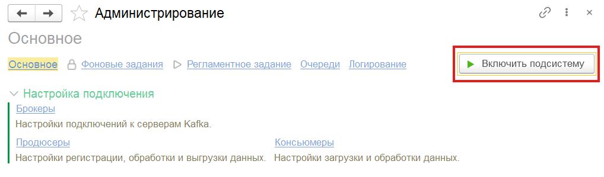
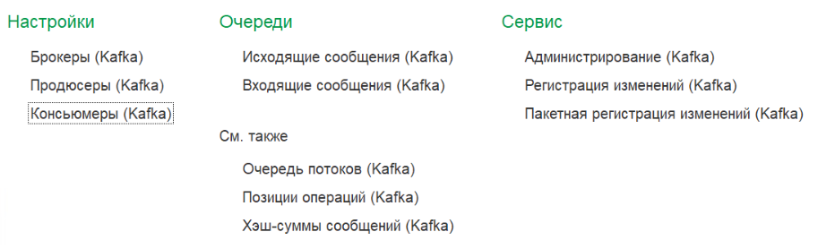

# Настройка подсистемы

Выполняйте настройку в режиме 1С:Предприятие после [установки и адаптации](../installation/index.md).

## Включение подсистемы { #enable-integration }

Откройте **Kafka → Администрирование** и нажмите **Включить подсистему**.

{ loading=lazy }

## Что настроить { #setup }

| Задача | Страница |
|---|---|
| Подключить кластер Kafka | [Брокеры](brokers.md) |
| Публиковать изменения из 1С | [Продюсеры](producers.md) |
| Читать топики и обрабатывать данные в 1С | [Консьюмеры](consumers.md) |
| Задать расписание и пользователя обмена | [Фоновые и регламентные задания](jobs.md) |
| Настроить сроки хранения и уведомления | [Очереди и уведомления](alerts.md) |
| Записывать логи компоненты и выгружать историю обмена | [Логирование](logging.md) |

Для проверки первого сообщения пройдите [выгрузку](../../start/outgoing.md) или [загрузку](../../start/incoming.md). Команды приостановки и перезапуска находятся на вкладке [Фоновые задания](jobs.md#background-jobs).

## Разделы меню Kafka { #menu }

{ loading=lazy }

Открывайте карточки брокеров, продюсеров и консьюмеров в группе **Настройки**. В группе **Очередь сообщений** доступны входящие и исходящие записи. В группе **Сервис** находятся администрирование и команды регистрации изменений.
