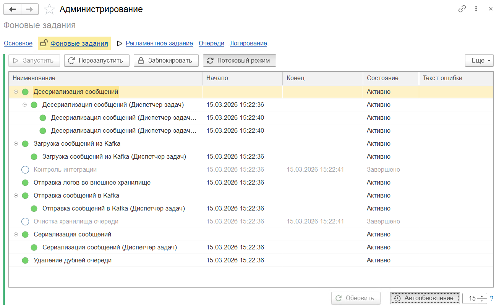
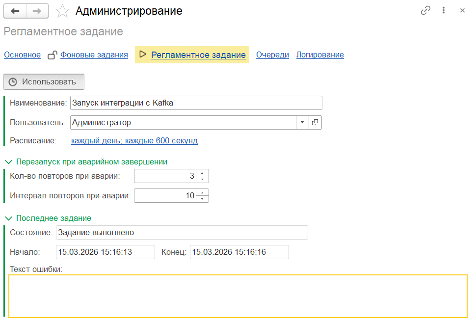

# Фоновые и регламентные задания

## Фоновые задания

Откройте **Kafka / Администрирование / Фоновые задания**.

{ loading=lazy }

На этой вкладке отображается состояние всех потоков подсистемы (сериализация, десериализация, выгрузка, загрузка).

**Кнопка «Заблокировать / Разблокировать»** — временная приостановка обмена без отключения подсистемы:

- **Заблокировать** — все потоки останавливаются после завершения текущей порции.
- **Разблокировать** — потоки возобновляют работу.

## Применение изменений настроек { #settings-restart }

Настройки кэшируются при старте фонового потока. Для применения изменений регламентное задание проверяет время последней записи настроек и время запуска самого старого активного потока. Автоматический перезапуск охватывает оба направления обмена и особенно важен в [потоковом режиме](#потоковый-режим), когда задания остаются активными между порциями.

!!! important "Условия автоматического перезапуска"

    - **Только при использовании регламентного задания.** Автоперезапуск выполняется в его обработчике. При ручном управлении потоками их перезапуск также выполняйте вручную кнопкой **Перезапустить**.
    - **Учитывается факт записи данных в базу.** Фактическое изменение значений не проверяется: повторное сохранение тех же настроек тоже обновляет отметку и учитывается при проверке перезапуска.
    - **Не раньше чем через одну минуту после последней записи настроек адаптера.** Каждая новая запись отслеживаемых настроек начинает отсчёт заново. Перезапуск выполняется при очередном запуске регламентного задания после истечения этого интервала.

Запись фиксируется для следующих настроек:

- брокеров, продюсеров и консьюмеров, включая группы диспетчеров задач;
- каталога логирования компоненты и формата имени файлов логирования;
- параметров внешнего логирования и очистки хранилища.

Запись с признаком **ОбменДанными.Загрузка** и запись с установленным отказом пропускаются. Для других настроек автоматический перезапуск этой проверкой не предусмотрен.

При каждом запуске регламентного задания проверка работает так:

1. Если активных потоков или отметки изменения нет, выполняется обычный запуск потоков.
2. Если самый старый активный поток запущен позже изменения настроек, перезапуск не требуется.
3. Если после последней записи прошло менее **60 секунд**, перезапуск откладывается до следующего запуска регламентного задания. Работающие потоки продолжают обмен с прежними настройками; обычная логика запуска потоков выполняется и в этом случае. Каждая новая запись настроек сдвигает начало интервала ожидания.
4. В остальных случаях обработчик включает общую блокировку обмена, ожидает завершения активных потоков, снимает блокировку и запускает потоки заново с актуальными настройками. Перезапускаются все найденные активные потоки адаптера, включая подпотоки и служебные операции.

Применение изменений зависит от расписания регламентного задания и времени завершения потоков. **60 секунд — минимальный интервал после последней записи настроек перед перезапуском, а не гарантированное время их применения.** Общий предельный срок ожидания завершения потоков не задан.

Для автоматического применения регламентное задание должно выполняться, подсистема должна быть включена, а блокировка обмена — снята. Штатные ограничения БСП также продолжают действовать.

Если ожидание завершения потоков заканчивается ошибкой, временная блокировка снимается, а ошибка передаётся вызывающему коду. Новые потоки в этом выполнении задания не запускаются. После устранения причины ошибки обмен может продолжиться при следующем запуске задания или ручном перезапуске.

!!! note "Блокировка во время перезапуска"
    Общую блокировку устанавливает и снимает обработчик автоматического перезапуска. Если вы меняли её вручную во время ожидания завершения потоков, после окончания перезапуска проверьте её состояние.

Чтобы применить настройки вручную, в том числе не охваченные автоматической проверкой:

1. Сохраните изменения настроек.
2. Откройте **Kafka / Администрирование / Фоновые задания**.
3. Нажмите **Перезапустить**. Новые потоки загрузят актуальные настройки.

## Регламентное задание

Откройте **Kafka / Администрирование / Регламентное задание** и активируйте задание `Использовать`. Там же задаются:

- **Расписание запуска** — интервал запуска диспетчера;
- **Пользователь обмена** — от имени какого пользователя выполняются фоновые задания.

{ loading=lazy }

При [подключении к подсистемам БСП](../installation/adaptation.md#подключение-к-подсистемам-бсп) задание зависит от включения подсистемы Kafka (`кфкИспользоватьИнтеграцию`) и учитывается БСП как работающее с внешними ресурсами.

Перед запуском потоков выполняются штатные проверки БСП. Если для задания действует блокировка работы с внешними ресурсами, например после копирования или переноса информационной базы, БСП отключает задание и прерывает его выполнение. Причина записывается в журнал регистрации 1С. Разрешение работы с внешними ресурсами и индивидуальные разрешения запуска заданий управляются штатными средствами БСП.

Для запуска потоков также должна быть снята блокировка обмена на вкладке **«Фоновые задания»**.

## Потоковый режим

При необходимости включите **«Использовать потоковый режим»**.

В этом режиме фоновые задания (сериализация, десериализация, выгрузка, загрузка) **не завершаются** после обработки очереди, а остаются активными и ждут появления новых данных.

Для потоков обработки локальных очередей действует тайм-аут простоя **5 минут**. У потоков загрузки из Kafka другое условие: тайм-аут действует, когда потоку не назначены консьюмеры. Если консьюмеры назначены, поток продолжает опрашивать Kafka даже при отсутствии новых сообщений.

!!! tip "Когда включать"
    Потоковый режим оправдан при высокой нагрузке, когда время запуска фонового задания соизмеримо с временем обработки порции. Для редкого обмена (несколько сообщений в час) — оставьте обычный режим.

## Требования к пользователю обмена

Пользователь, указанный в регламентном задании, должен иметь:

- права на запуск **фоновых заданий**;
- доступ к регистрам и справочникам подсистемы;
- права на регистрацию событий в журнале регистрации 1С;
- (если настроен внешний логгер) доступ к интернет-ресурсам сервера 1С для отправки логов.

## Требования к серверу 1С

На сервере 1С должны быть **разрешены фоновые задания** (параметр кластера). Если задания не запускаются — см. [Типовые проблемы](../operations/troubleshooting.md#фоновые-задания-не-запускаются).
