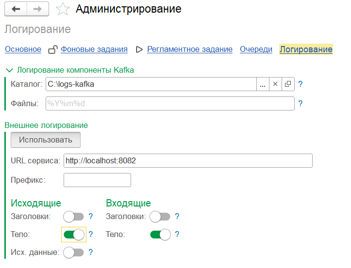

# Логирование

Откройте **Kafka / Администрирование / Логирование**.

{ loading=lazy }

## Логирование компоненты Kafka

Низкоуровневые логи внешней компоненты (librdkafka) в файлы на сервере 1С.

| Поле | Описание |
|------|----------|
| **Каталог** | Путь на сервере для лог-файлов внешней компоненты |
| **Файлы** | Формат даты в имени лог-файла (strftime, по умолчанию `%Y%m%d` — новый файл каждый день) |

Каталог должен существовать и быть доступен **серверным процессам 1С для записи**. Локальный путь на клиентской машине не подходит: компонента создаёт файлы на сервере 1С. После записи каталога или формата имени файлов [автоперезапуск потоков](jobs.md#settings-restart) выполняется **только при использовании регламентного задания и не раньше чем через одну минуту после последней записи**. Учитывается факт записи в базу, даже без изменения значений. При ручном запуске потоков перезапускайте их вручную.

### Именование лог-файлов

Имена файлов формируются по шаблону:

```
{type}_{client.id}_{pid}_{dateformat}.log
```

| Плейсхолдер | Значение |
|-------------|----------|
| `type` | Тип логгера: `producer`, `consumer`, `statistics`, `dump` |
| `client.id` | Идентификатор клиента — параметр `client.id` продюсера/консьюмера |
| `pid` | Идентификатор процесса на сервере 1С |
| `dateformat` | Дата в формате из поля **Файлы** (по умолчанию `%Y%m%d`) |

Так логи разных продюсеров, консьюмеров и рабочих процессов разводятся по отдельным файлам, а по дате файлы ротируются.

!!! info "Когда нужны эти логи"
    Подключение, отправка, ошибки брокера, SASL/SSL — всё это фиксируется здесь на низком уровне. Полезно для отладки сетевых проблем и проблем аутентификации.

## Внешнее логирование

Выгрузка **журнала обмена** в совместимый HTTP/HTTPS-приёмник. Адаптер отправляет `POST` с gzip-сжатым JSON-массивом событий, заголовками `Content-Type: application/json` и `Content-Encoding: gzip`; успешным считается ответ **HTTP 200**.

Для передачи в Logstash, Elasticsearch, OpenSearch или Loki приёмник должен принять этот формат и при необходимости преобразовать его в формат выбранного хранилища. Адрес API хранилища, принимающий произвольный JSON, сам по себе не гарантирует совместимость.

| Поле / кнопка | Описание |
|---------------|----------|
| **Использовать** | Включает/выключает выгрузку |
| **URL сервиса** | Адрес эндпоинта (например, `https://hostname:8080/my-logs`) |
| **Префикс** | Префикс, добавляемый к имени логгера (см. ниже) |
| **Исходящие — Заголовки / Тело / Исх. данные** | Что выгружать по исходящим сообщениям |
| **Входящие — Заголовки / Тело** | Что выгружать по входящим сообщениям |

### Что даёт внешнее логирование

- **История обмена в привычных инструментах** (Kibana, Grafana Loki Explore).
- **Поиск и аналитика** по огромным объёмам данных без нагрузки на 1С.
- **Срок хранения** в 1С можно уменьшить (`-2` — удалять после выгрузки), когда приёмник подтверждает сохранение событий ответом HTTP 200. Дальнейшее хранение определяется внешней системой.
- **Обновление текущего состояния сообщений** во внешнем хранилище возможно, если приёмник настроен на upsert по передаваемому `id` (см. ниже).

### Именование логгеров

Записи выгружаются с именем логгера по шаблону:

```
[префикс-]kfk-producer
[префикс-]kfk-consumer
```

где `префикс` — значение поля **Префикс** (может быть пустым). Идентификатор конкретного продюсера/консьюмера в имя логгера **не входит** — иначе каждая настройка порождала бы отдельный индекс в Elasticsearch / OpenSearch, что приводит к разрастанию числа индексов и ошибкам на стороне хранилища.

### Как работает выгрузка

- Выгрузка в HTTP-эндпоинт идёт после минутной задержки от метки изменения записи в РС «Исходящие / Входящие сообщения». Задержка группирует промежуточные статусы и уменьшает количество отправляемых записей.
- Исходящие и входящие логи выбираются ограниченными порциями: `МеткаИзменения > Позиция` и ниже временной границы, с сортировкой по полной комбинированной метке изменения. После HTTP-ответа с кодом `200` сохраняется метка последней строки порции; при ошибке сохранённая позиция не меняется, порция будет прочитана повторно. При отсутствии событий позиция может продвинуться до временной границы «текущее время минус 15 минут».
- Порционная выгрузка требует уникальных меток изменения внутри каждого направления: строки с одинаковой меткой на границе порции могут быть пропущены. Перед запуском на исторических данных проверьте результат миграции по [инструкции обновления](../installation/updating.md#переход-на-комбинированные-метки).
- Каждая запись журнала содержит **идентификатор события**: полную первичную метку и ключ записи регистра.
- Примеры настройки внешнего логирования для **Elasticsearch** и **OpenSearch** — в репозитории [ShadobaAI/kafka-tools](https://github.com/ShadobaAI/kafka-tools). Для модели «одно сообщение — один документ текущего состояния» приёмник должен выполнять **upsert по `id`**. Адаптер передаёт стабильный `id`, но сам не задаёт способ записи во внешнее хранилище.

!!! tip "Следствие для дашбордов"
    При настроенном upsert по `id` и подтверждённой загрузке актуальных событий документ отражает **текущее** состояние сообщения. Тогда отчёты можно строить без подсчёта повторных переходов статусов. При добавлении каждого события отдельной записью потребуется учитывать повторы и историю состояний.

### Поля событий в JSON

#### Общие поля

| Поле | Тип JSON | Значение |
| --- | --- | --- |
| `id` | строка | Стабильный идентификатор записи в формате `КлючЗаписи_ПервичнаяМетка`. Первичная метка берётся целиком из `МеткаРегистрации` для исходящих и из `МеткаЗагрузки` для входящих. |
| `logger` | строка | Имя логгера с учётом направления обмена и настроенного префикса. |
| `infobase` | строка | Идентификатор инфобазы. Для серверной базы используется `Srvr\Ref`, для файловой — путь из `File`. В остальных случаях передаётся строка соединения. |
| `record_key` | строка | Ключ записи очереди (`КлючЗаписи`). |
| `message_key` | строка | Ключ сообщения, сохранённый в регистре. |
| `status` | строка | Значение перечисления статусов сообщений в строковом представлении 1С (`XMLСтрока`). |
| `log_text` | строка | Текст журнала из записи сообщения. |
| `processing_date` | строка | Дата и время обработки из записи регистра. |
| `processing_duration_ms` | число | Длительность обработки в миллисекундах. |
| `processing_count` | число | Количество попыток обработки из записи регистра. |
| `msg_headers` | строка | Заголовки в формате `ключ=значение,ключ=значение`. Поле добавляется при включённой выгрузке заголовков, если есть значения поддерживаемых типов. Ключи и значения преобразуются через `XMLСтрока`. |
| `msg_body` | строка для текстового тела | Тело сообщения. Поле добавляется при включённой выгрузке тела и непустом значении. JSON-тело передаётся как текст. |
| `@timestamp` | строка | Время UTC из первичной метки. Для исходящих это время регистрации, для входящих — время загрузки. |
| `combined_mark` | строка | Полная метка изменения в десятичной записи. |
| `change_mark_timestamp` | строка | Время UTC из метки последнего изменения записи очереди. |
| `change_mark_session_number` | число | Номер сеанса в метке изменения. |
| `change_mark_sequence_number` | число | Порядковый номер в метке изменения. |

При двоичном теле выгрузчик использует значение из регистра в исходном типе `ДвоичныеДанные`.

Поля `processing_date`, `registration_date`, `export_date`, `write_date` и `load_date` передаются в формате ISO 8601 с локальным смещением UTC. При пустой дате соответствующее поле отсутствует.

#### Поля исходящих сообщений

| Поле | Тип JSON | Значение |
| --- | --- | --- |
| `producer_id` | строка | Ссылка на продюсера в строковом представлении 1С (`XMLСтрока`). |
| `producer_name` | строка или `null` | Наименование продюсера. |
| `object_type` | строка | Тип объекта 1С из регистрации сообщения. |
| `source_type` | строка | Тип исходных данных из регистрации сообщения. |
| `object_key` | строка | Ключ объекта 1С, сохранённый при регистрации. |
| `trigger` | строка | Событие регистрации в строковом представлении 1С (`XMLСтрока`). |
| `registration_date` | строка | Дата и время регистрации в очереди. |
| `export_date` | строка | Дата и время выгрузки в Kafka. |
| `export_count` | число | Количество попыток выгрузки в Kafka из записи регистра. |
| `registration_mark_session_number` | число | Номер сеанса в метке регистрации. |
| `registration_mark_sequence_number` | число | Порядковый номер в метке регистрации. |
| `source` | строка | Исходные данные. Поле добавляется при включённой выгрузке исходных данных и строковом значении. Из XML удаляются объявления пространств имён, префиксы `d3p1:` и `xsi:`, а также пробелы между тегами. |
| `is_delete` | булево | Признак удаления объекта 1С. Передаётся вместе с `source`. |

#### Поля входящих сообщений

| Поле | Тип JSON | Значение |
| --- | --- | --- |
| `consumer_id` | строка | Ссылка на консьюмера в строковом представлении 1С (`XMLСтрока`). |
| `consumer_name` | строка или `null` | Наименование консьюмера. |
| `topic` | строка | Имя топика Kafka. |
| `partition` | число | Номер раздела Kafka. |
| `offset` | число | Смещение сообщения в разделе Kafka. |
| `write_date` | строка | Дата и время записи сообщения по `timestamp` Kafka. |
| `load_date` | строка | Дата и время загрузки сообщения в очередь 1С. |
| `load_date_ms` | число | Время из метки загрузки в миллисекундах от `01.01.0001` UTC. |
| `load_mark_session_number` | число | Номер сеанса в метке загрузки. |
| `load_mark_sequence_number` | число | Порядковый номер в метке загрузки. |
| `waiting_time` | число | Сохранённая задержка отложенного повтора в секундах. `0` соответствует отсутствию сохранённой задержки или явно заданной нулевой задержке. После завершения обработки поле может сохранять последнее записанное значение. |

Для входящего сообщения в статусе **«Новое»** с положительным `waiting_time` прибавьте `waiting_time` секунд к местному времени `processing_date`, чтобы получить срок фонового повтора. После раннего прохода в следующем выгруженном событии `change_mark_timestamp` может измениться при прежних `processing_date`, `processing_duration_ms` и `processing_count`.

### Метки в JSON

Полная метка передаётся строкой, поскольку число длиной до 30 знаков может потерять точность у потребителя JSON.

`@timestamp` и `change_mark_timestamp` передаются в UTC с суффиксом `Z`. Остаток миллисекунд записывается после точки без ведущих нулей. Например, остаток 5 мс даёт окончание `.5Z`. Точное значение времени загрузки доступно в `load_date_ms`, а полная метка изменения — в `combined_mark`.

У исторических меток компонент номера сеанса равен `0`. Обработчик миграции использует один порядковый номер для обоих полей сообщения. Счётчик циклический `1..99999999` и сквозной для каждого регистра в пределах одного вызова. Временная составляющая определяется сохранёнными миллисекундами.

После преобразования старых меток меняется `id` уже опубликованных сообщений. При повторной выгрузке граничной миллисекунды во внешнем хранилище возможны дубли со старым и новым `id`. Учтите это при обновлении индекса или дашбордов.

### Требования

- На сервере 1С должен быть доступен **интернет-ресурс** по указанному URL.
- Пользователь обмена должен иметь право использовать **HTTP-соединения**.

!!! tip "Срок хранения `-2`"
    Если настроен внешний логгер — ставьте **-2** для статусов, по которым не нужна долгая локальная история (например, «Обработано» и «Выгружено»). Это сильно разгрузит РС «Исходящие / Входящие сообщения».
