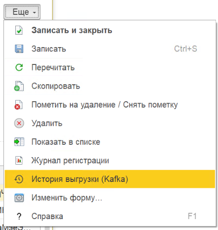
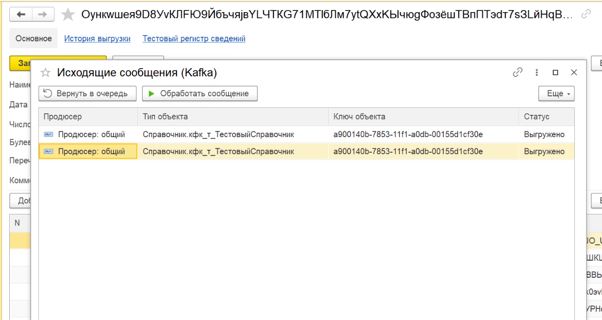

# Мониторинг очередей

## Основные инструменты

| Инструмент | Где открыть | Назначение |
|-----------|------------|-----------|
| **Фоновые задания** | Kafka / Администрирование / Фоновые задания | Состояние потоков, ошибки фоновых заданий |
| **Регламентное задание** | Kafka / Администрирование / Регламентное задание | Мониторинг выполнения регламентного задания |
| **РС «Исходящие сообщения»** | Kafka / Исходящие сообщения | Детальный просмотр очереди исходящих, [ручные операции](statuses.md#manual-actions), [очистка](queue-maintenance.md) |
| **РС «Входящие сообщения»** | Kafka / Входящие сообщения | Детальный просмотр очереди входящих, [ручные операции](statuses.md#manual-actions), [очистка](queue-maintenance.md) |

## История выгрузки объекта

Посмотреть, ушёл ли конкретный объект в Kafka, можно прямо из его формы — команда **«История выгрузки (Kafka)»** открывает форму списка РС «Исходящие сообщения» с отбором по записям этого объекта. Команда доступна двумя способами:

- **Подключаемая команда БСП** — появляется в командной панели форм всех объектов, участвующих в интеграции (группа «См. также»);
- **Глобальная команда с горячей клавишей <kbd>Ctrl</kbd> + <kbd>H</kbd>** — определяет объект по активному окну и открывает его историю выгрузки; работает и из формы объекта, и из формы списка.

{ loading=lazy }

{ loading=lazy }

Программный вызов из своих форм — [`кфкИнтеграцияКлиент.ИсторияВыгрузкиОбъекта`](../development/api.md#object-export-history).

## Что проверять { #what-to-monitor }

- **Очередь.** Сравните количество записей в статусах **Новое** и **Обработано** в начале и конце одного интервала. Для исходящих второй статус означает готовность к отправке.
- **Ошибки.** Откройте сообщения в статусах **Ошибка обработки** и **Ошибка выгрузки**, изучите журнал записи и счётчики.
- **Фоновые задания.** Сопоставьте состояние потоков с расписанием и блокировками. В обычном режиме потоки могут завершаться между запусками.
- **Хранение.** Если накапливается история уже обработанных сообщений, проверьте [сроки хранения](../configuration/alerts.md) и состояние выгрузки журналов.

[Диагностика роста очереди](troubleshooting.md#growing-queue) · [Фактические задержки и скорость обработки](performance.md#measurements)

## Примеры запросов для мониторинга { #monitoring-queries }

Готовые шаблоны запросов 1С, которые можно выполнять в консоли запросов, обработках-отчётах или регламентных проверках.

### Количество сообщений по статусам

```bsl
ВЫБРАТЬ
	Т.Статус КАК Статус,
	КОЛИЧЕСТВО(*) КАК Количество
ИЗ
	РегистрСведений.кфкИсходящиеСообщения КАК Т

СГРУППИРОВАТЬ ПО
	Т.Статус

УПОРЯДОЧИТЬ ПО
	Т.Статус
```

```bsl
ВЫБРАТЬ
	Т.Статус КАК Статус,
	КОЛИЧЕСТВО(*) КАК Количество
ИЗ
	РегистрСведений.кфкВходящиеСообщения КАК Т

СГРУППИРОВАТЬ ПО
	Т.Статус

УПОРЯДОЧИТЬ ПО
	Т.Статус
```

## Смотрите также

- [Статусы сообщений](statuses.md).
- [Обслуживание очередей](queue-maintenance.md) — автоматическая и ручная очистка.
- [Диагностика](diagnostics.md).
- [Алерты и контроль интеграции](../configuration/alerts.md).
