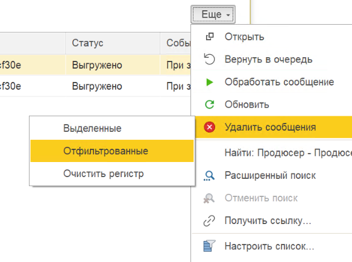

# Обслуживание очередей

Локальные очереди хранятся в регистрах **Исходящие сообщения** и **Входящие сообщения**. Записи удаляются по правилам хранения или вручную из списка.

## Автоматическая очистка { #automatic-cleanup }

Задайте сроки для нужных состояний на вкладке **Kafka → Администрирование → Очереди**. Очистку запускает регламентное задание. История хэшей имеет отдельный срок хранения. [Значения сроков и условия удаления](../configuration/alerts.md)

Первичная комбинированная метка идентифицирует запись. Метка изменения служит для отбора фоновых операций. Формы показывают полную метку, время, номер сеанса и порядковый номер. [Миграция старых меток](../installation/updating.md#combined-markers-migration)

## Ручная очистка локальной очереди { #manual-queue-cleanup }

Остановите обмен, дождитесь завершения потоков и откройте одну из очередей. В группе **Удалить сообщения** выберите область удаления и проверьте её в диалоге подтверждения.

| Команда | Область удаления |
|---|---|
| **Удалить выделенные** | Выделенные в списке записи. |
| **Удалить отфильтрованные** | Записи по отборам списка, например по продюсеру или консьюмеру. |
| **Очистить регистр** | Все записи выбранной очереди. |

{ loading=lazy }

Команды доступны при включённой блокировке интеграции или отключённом регламентном задании, когда активных потоков уже нет. Для записи в регистр нужны права администратора адаптера. Удаление выполняется порциями в фоновом задании. [Остановка потоков](../configuration/jobs.md#background-jobs) · [Роли и права](../installation/roles.md)

Ручное удаление записей из списка действует на выбранный регистр сообщений. История хэшей хранится отдельно. Для новой попытки обработки используйте [ручные команды в очереди](statuses.md#manual-actions).
