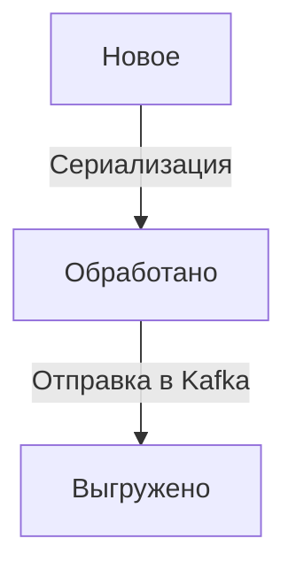

# Статусы сообщений

Откройте **Kafka → Исходящие сообщения** или **Kafka → Входящие сообщения**. Статус показывает этап обмена, а журнал конкретной записи — причину ошибки или отмены.

## Исходящая очередь { #outgoing }

Обычный маршрут проходит через сериализацию. Запись с готовым телом сразу получает состояние **Обработано**.

| Статус | Что означает |
|---|---|
| **Новое** | Зарегистрированы данные, для которых нужно сформировать тело сообщения. |
| **Обработано** | Тело готово к выгрузке. |
| **Выгружено** | Адаптер получил подтверждение отправки от внешней компоненты. |
| **Ошибка обработки** | Сериализация завершилась с ошибкой. |
| **Ошибка выгрузки** | На этапе отправки произошла ошибка. Смотрите журнал и число попыток. |
| **Обработка отменена** | Обработчик отменил сериализацию или запись признана дублем более поздней регистрации. |
| **Выгрузка отменена** | При включённой идемпотентной отправке хэш тела совпал с хэшем последней успешной выгрузки по ключу записи. |

Подробности отбора старых регистраций и проверки хэшей приведены в [настройках продюсера](../configuration/producers.md#registration-deduplication).

## Входящая очередь { #incoming }

| Статус | Что означает |
|---|---|
| **Новое** | Сообщение сохранено в очереди и ждёт обработки или очередной попытки после задержки. |
| **Обработано** | Прикладная обработка завершилась успешно. |
| **Обработка отменена** | Прикладной обработчик отменил операцию или адаптер пропустил уже обработанное тело при проверке хэша. |
| **Ошибка обработки** | Не найдено правило, произошла ошибка вызова либо запрос повтора вышел за лимиты. Причина указана в журнале записи. |

Решения, которые может вернуть обработчик, описаны на странице [Обработчик консьюмера](../development/consumer-handler.md#result).

## Автоматический повтор { #automatic-retry }

- **Ошибка выгрузки.** Фоновая операция повторяет отправку, пока число попыток меньше трёх. В лимит входит первоначальная отправка. После исчерпания попыток используйте команду **Вернуть в очередь**.
- **Ошибка обработки.** Для новой попытки сначала устраните причину, затем запустите обработку вручную или верните запись в очередь.
- **Отложенный повтор входящего.** Запись остаётся в статусе **Новое**. Обработка возобновляется при фоновом отборе после задержки, отсчитанной от начала предыдущей попытки. [Правила и пределы отложенного повтора](../development/consumer-handler.md#deferred-retry)

## Ручные операции в очередях { #manual-actions }

| Команда | Действие |
|---|---|
| **Обработать сообщение** | Запускает сериализацию исходящей записи или десериализацию входящей. Для входящего сообщения можно начать обработку при действующей задержке. Ключ записи должен быть свободен. |
| **Вернуть в очередь** | Переводит **Ошибку обработки** в **Новое**, а **Ошибку выгрузки** — в **Обработано** для повторной отправки. |
| **Пометить как дубль** | Помечает исходящую запись статусом **Обработка отменена** с причиной «Дубль». |
| **Удалить сообщения** | Удаляет записи выбранным способом. [Обслуживание очередей](queue-maintenance.md) |

Команда **Обработать сообщение** доступна пользователю с полными правами при отсутствии активных потоков, если интеграция заблокирована или её регламентное задание отключено. В списке выберите одну запись.

[Где смотреть ошибки и журнал](diagnostics.md) · [Что проверить по симптомам](troubleshooting.md)
